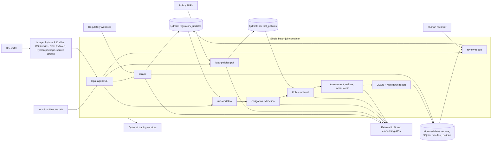

# Legal Agent

A tool to help legal teams track new laws and update company rules.

The agent finds new regulatory material online and compares extracted obligations with
written company policies. Its reports are draft policy-coverage assessments for human
review; they do not establish that operational controls work or that the organisation
is legally compliant.

## How It Works

The process has seven steps:

1. **Scrape:** It finds new laws on the web.
2. **Extract:** It identifies quoted obligations in every source chunk.
3. **Retrieve:** It finds candidate policy text for each obligation.
4. **Analyze:** It assesses written policy coverage for each obligation.
5. **Draft:** It proposes text for identified policy gaps.
6. **Model audit:** It checks the draft for inconsistencies.
7. **Human review:** A person decides whether to approve or reject the report.

Workflow steps (Agents):

1. `Horizon Scanner`: groups unprocessed regulation chunks back into complete documents.
2. `Obligation Extractor`: returns source-quoted duties for each document chunk.
3. `Librarian`: runs hybrid retrieval against internal policies per obligation.
4. `Relevance Check`: filters out site noise and non-regulatory content.
5. `Analyst`: assesses policy coverage with validated source and policy citations.
6. `Redliner`: drafts policy amendments in redline form.
7. `Auditor`: checks for hallucinations, weak reasoning, and draft mismatch before review.

## Tools in Use

We use a few key tools to build this agent:

- **Scrapy:** Crawls websites to find new legal texts.
- **Docling:** Turns PDF files into plain text.
- **Qdrant:** A smart database. It stores and finds the right text chunks fast.
- **LlamaIndex:** Runs the step-by-step agent logic.
- **Langfuse & Phoenix:** Tracks costs and AI choices so you can test the agent.

# Architecture

The project was built around one core requirement from the original project plan: make the workflow inspectable and easy to evaluate. The architecture therefore favors explicit workflow steps, stored intermediate artifacts, and trace-friendly integrations over opaque agent loops.

```
Scrapy Spider ──► Qdrant (regulatory_updates)
                          │
          ComplianceWorkflow (LlamaIndex)
          ┌─────────┼─────────────────────┐
    Horizon ──► Obligation ──► Librarian ──► Analyst
    Scanner      Extractor     (RAG retrieval)  (coverage)
                                                │
                                     Redliner ──► Model audit
                                                    │
                                             Report ──► Human review
```

## Quick Start

Here is how to run the agent on your machine.

### 1. Install

```bash
pip install -e ".[dev]"
```

### 2. Set Up Keys

Copy the example file to make your own config.

```bash
cp .env.example .env
```

Open the `.env` file. Add your keys.

#### Minimum requirements:

- `OPENAI_API_KEY`
- `OPENAI_EMBEDDING_MODEL`
- `QDRANT_URL`
- `QDRANT_API_KEY`
- `LOCAL_LLM_BASE_URL` when `USE_LOCAL_LLM=true`

#### Optional but useful:

- `GEMINI_API_KEY`, `GEMINI_MODEL` if you want Gemini for workflow steps
- `VOYAGE_API_KEY`
- `LANGFUSE_PUBLIC_KEY`, `LANGFUSE_SECRET_KEY`, `LANGFUSE_HOST`
- `PHOENIX_ENDPOINT`
- `LANGWATCH_API_KEY`

### 3. Set Up the Database

Create the tables in Qdrant.

```bash
legal-agent init-db
```

### 4. Add Your Policy

Load your company rules into the database.

```bash
legal-agent load-policies-pdf "data/policies/your-policy.pdf"
```

### 5. Scrape New Laws

Find and save new rules from the web.

```bash
legal-agent scrape
```

You can change the sites to scrape in `data/sources/targets.json`.

### 6. Run the Agent

Start the main job.

```bash
legal-agent run-workflow
```

The agent processes all complete, pending regulatory documents and saves one JSON and
one Markdown report per document in `data/reports/`. It saves both files before marking
the document processed in Qdrant. A model audit pass produces `pending_human_review`.

### 7. Record a human decision

Inspect the source, policy citations, proposed changes, and model audit notes in the
report. Then record a decision with a reviewer identity and rationale:

```bash
legal-agent review-report data/reports/<report-name>.md \
  --decision approve --reviewer "your-name" --reason "Reviewed source and policy evidence"
```

`approve` is allowed only for `pending_human_review`. A reviewer can `reject` a report
that is pending review or marked `review_required`. The decision and timestamp are
written to both report formats and reflected in Qdrant. The command does not edit an
internal policy or implement a control.

## CLI Commands


| Command                         | What It Does                           |
| ------------------------------- | -------------------------------------- |
| `legal-agent init-db`           | Sets up the database.                  |
| `legal-agent scrape`            | Finds new laws on the web.             |
| `legal-agent retry-dead-letters` | Requeues failed acquisitions for retry. |
| `legal-agent run-workflow`      | Runs the main agent task.              |
| `legal-agent review-report`     | Records a human approval or rejection. |
| `legal-agent load-policies-pdf` | Loads a PDF policy into the database.  |
| `legal-agent status`            | Shows how many laws are left to check. |


## Tracing and evals (quick start)

Observability runs when you call `legal-agent run-workflow`: `init_observability()` wires **Langfuse**, **Arize Phoenix**, and optionally **LangWatch**. Set the keys below in `.env`.

### Langfuse (cloud)

1. Create a project in [Langfuse Cloud](https://cloud.langfuse.com) and create API keys.
2. In `.env`:
  - `LANGFUSE_PUBLIC_KEY=...`
  - `LANGFUSE_SECRET_KEY=...`
  - `LANGFUSE_HOST=https://cloud.langfuse.com` (this is also the default in `config.py` if you omit it)
3. Run a workflow, then open the Langfuse UI and find your traces for that session.

### Langfuse (local with Docker)

Self‑hosted Langfuse needs its full stack (see the official [self‑hosting guide](https://langfuse.com/docs/deployment/self-host)). Typical pattern:

1. Use the upstream project’s `docker-compose` (Postgres, ClickHouse, MinIO, workers, web) and start it.
2. Finish first‑time setup in the web UI and create project keys.
3. Point the app at your instance, for example:
  - `LANGFUSE_HOST=http://localhost:3000`
  - `LANGFUSE_PUBLIC_KEY=...`
  - `LANGFUSE_SECRET_KEY=...`
4. **Dashboard:** open `http://localhost:3000` in your browser (or the host/port you published in compose).

### Arize Phoenix (local UI + traces)

This repo sends OTEL traces to Phoenix at `PHOENIX_ENDPOINT` (HTTP OTLP path `/v1/traces` is appended in code).

**Option A – Phoenix already running (Docker or manual server)**

1. Start Phoenix so the UI is on port **6006** (see [Arize Phoenix docs](https://docs.arize.com/phoenix) for the current Docker image / command).
2. In `.env`:
  - `PHOENIX_ENDPOINT=http://localhost:6006`
  - `PHOENIX_EXTERNAL=true`
   So the app does **not** try to spawn another server; it only exports spans to the running instance.
3. **Dashboard:** open `http://localhost:6006` and inspect traces / LlamaIndex spans.

**Option B – Let the workflow launch Phoenix**

1. In `.env`:
  - `PHOENIX_ENDPOINT=http://localhost:6006`
  - `PHOENIX_EXTERNAL=false`
   When `localhost` is in the URL and `PHOENIX_EXTERNAL` is false, `phoenix.launch_app()` can start the server for you during `run-workflow`.
   Install the optional local server first with `pip install -e '.[phoenix]'`.
2. Open `http://localhost:6006` for the Phoenix UI.

### Run the workflow with tracing on

```bash
legal-agent run-workflow
```

If Langfuse keys are missing, Langfuse init is skipped (warning in logs). If PHOENIX_ENDPOINT is wrong or Phoenix is not reachable, Phoenix init may log a warning and skip RAG-style observability for that run.


# Configurations

**Note:** The `src/legal_agent/config.py` file is the central configuration hub for the entire workflow. You should use it to configure all LLMs, embedding models, tokenizers, and other system parameters before running the agent.

## Vector Collection

Qdrant is used as both the staging layer and the retrieval layer:

- `regulatory_updates` stores scraped regulation chunks plus processing state
- `internal_policies` stores chunked internal policy text for retrieval
The collections are configured with dense and sparse vectors so the system can support hybrid retrieval rather than pure cosine similarity alone.

## Regulatory acquisition

Configured sources use source-specific adapters. The EDPB adapter polls the official
publications feed first and uses the configured publication pages as a targeted
backfill; it does not follow arbitrary links by default. EUR-Lex/CELLAR documents are
configured explicitly by URL or CELEX identifier.

Before a document reaches enrichment or Qdrant, deterministic checks validate its
status, extracted length, navigation content, and legal-content signals. Only
borderline candidates use the cheaper content-validation model. Rejected documents
are recorded in `QUARANTINE_FILE`.

The document manifest at `MANIFEST_FILE` tracks canonical source identities and
content revisions. Unchanged revisions are skipped, while changed revisions
supersede older ones. Conversion, model, and persistence failures become
dead-lettered records that can be requeued with `legal-agent retry-dead-letters`.

Regulatory documents move from `pending` to `pending_human_review`, `review_required`,
or `irrelevant`. Only an explicit `review-report --decision approve` transition marks
a document `approved`. Extraction failures, unsupported assessments, uncertain policy
coverage, weak retrieval, and failed model audits require review. No model output alone
can approve a report.

## Obligation-centric workflow

`legal-agent run-workflow` extracts duties, prohibitions, deadlines, and conditional
requirements from every source chunk. Malformed extraction or an empty result requires
review. The Librarian then runs a
separate dense+sparse policy search for every obligation, expands adjacent policy
chunks, and optionally reranks the evidence. The Analyst and Auditor receive this
obligation-to-evidence mapping, rather than one undifferentiated policy bundle.

The retrieval gate requires each obligation to have candidate policy evidence meeting
the configured hit and score thresholds. This gate measures retrieval availability,
not legal sufficiency. Documents that fail it become `review_required` and do not
produce automatic gap analysis or redlines. The Analyst then returns one structured
policy-coverage assessment for each obligation. The code checks obligation IDs and
verbatim source and policy citations; malformed, missing, or uncertain assessments
also require review. Tune the bounded retrieval loop with
`OBLIGATION_RETRIEVAL_TOP_K`, `OBLIGATION_RETRIEVAL_FINAL_K`,
`OBLIGATION_MIN_EVIDENCE_HITS`, `OBLIGATION_MIN_RETRIEVAL_SCORE`, and
`OBLIGATION_NEIGHBOR_HOPS`.

## Container architecture and run

The Dockerfile builds one Python image with the CLI, workflow, scraping code, and
dependencies. The default command starts a batch workflow; the same image can run
`init-db`, `load-policies-pdf`, `scrape`, or `review-report` by overriding the command.



No queue, scheduler, API server, or multi-container deployment is included yet.
The container exits when its command finishes. Keep `data/` on durable storage so
reports and the SQLite acquisition manifest survive container replacement. Qdrant,
model endpoints, and optional tracing services must be reachable from the container.
Running multiple copies later will require shared report/manifest storage and a way
to claim work so two workers do not process the same document.

Build and run the workflow manually:

```bash
docker build -t legal-agent .
docker run --rm --env-file .env \
  -e QDRANT_URL=https://your-qdrant-host \
  -v "$PWD/data:/app/data" legal-agent legal-agent run-workflow
```

The image defaults to hosted LLM mode; configure the provider keys in `.env`.
The Docker image uses the CPU PyTorch wheels described in the
[PyTorch installation guide](https://pytorch.org/get-started/previous-versions/).
Deployment to a cloud account still requires environment-specific infrastructure
and credentials.

The three synthetic cases in `evals/cases.json` check the Analyst's policy-coverage
outcomes against labeled expectations. With a configured model, run
`python evals/run_analyst_eval.py`. This is a small prompt check, not a legal-quality
benchmark; expand it with reviewed examples and retrieval/end-to-end cases before
relying on model performance claims.

## LLM and Embedding Model choices

The code supports several operating modes to balance cost, performance, and domain specificity:

- **Local llama.cpp mode (default):** workflow and enrichment calls use the OpenAI-compatible server configured by `LOCAL_LLM_BASE_URL` (default `http://localhost:8001/v1`). Qwen thinking is disabled for enrichment and relevance, medium for the Analyst, low for the Redliner, and `xHigh` for the Auditor.
- **OpenAI mode:** set `USE_LOCAL_LLM=false`. Enrichment uses `gpt-4o-mini`; relevance, analysis, redlining, and audit use `gpt-5.6-luna` by default.
- **Gemini workflow mode:** set `USE_LOCAL_LLM=false` and `USE_GEMINI=true`. Per-step thinking levels remain configurable in `src/legal_agent/config.py`.
- **Local Legal Embeddings:** you can use `nlpaueb/legal-bert-base-uncased` instead of OpenAI embeddings by setting `USE_LEGAL_EMBEDDINGS=true`.

### Agent Routing

The current model routing is intentionally designed to optimize both cost and quality:

- `analyst`, `redliner`, and `auditor` steps require deep legal reasoning, so they are routed to stronger models (or higher thinking modes if using Gemini).
- `obligation_extractor` uses the analyst route once per document to produce structured duties for focused retrieval.
- `relevance_check` acts as a fast filter and can safely use a cheaper, faster model.
- `enrichment` runs with thinking disabled on the local Qwen model, or uses `gpt-4o-mini` in OpenAI mode.

This separation keeps high-volume, cost-sensitive steps cheap while preserving top-tier quality where complex reasoning matters most.

## License

See `LICENSE`.
